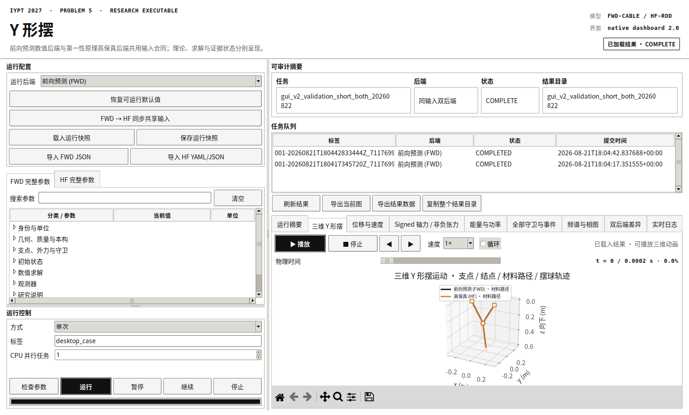

# Y 形摆原生本地桌面平台

## 1. 定位与边界

这是一个人科研计算工具，不是面向多用户或公网部署的产品。默认界面由 Python `tkinter` 与 Matplotlib 构成：

- 只创建本地原生窗口；
- 不启动浏览器，不监听 HTTP 端口；
- 不需要邮箱、账号、登录或联网；
- 不在 GUI 内重写物理方程，而是调用原 FWD 与 HF 求解器。

历史 Streamlit 界面保留为开发备份，不是默认入口。



## 2. 启动

在项目目录中执行：

```bash
.venv/bin/python -m ypendulum.cli ui
```

安装为本地包后也可以执行：

```bash
ypendulum ui
# 或
ypendulum-desktop
```

无显示器环境的构造性烟雾测试：

```bash
xvfb-run -a .venv/bin/python -m ypendulum.cli ui --smoke-test
```

旧 Web 备份只在显式请求时启动：

```bash
ypendulum ui-web
```

## 3. 界面结构

界面视觉层级参照同机涡流摆研究平台的当前版：黑白研究仪表盘、窄侧栏、
细边框卡片、顶部模型身份和右侧可审计结果区；并保留适合本项目长任务与
完整参数树的原生桌面交互。

- 左侧为运行配置、FWD/HF 完整参数和可拖动分隔的运行计划；
- 单次模式只显示本次需要的核心运行控件；切换到重复、批量或扫描模式时，
  相应的专用控件才展开；运行/暂停/停止固定在控制卡顶部，模式字段位于带
  明示滚动条的区域，因此最小窗口下也不会因扫描字段或长错误而失去操作入口；
- 右侧“可审计摘要”和“任务队列”可分别展开/收起；结果加载后两者默认
  各自收起，把纵向空间交给科学图，两个展开入口始终保留在顶部工具栏；
- 启动默认打开三维运动页，其他规范量保留为独立结果页，避免把不同物理
  语义强行挤在一张图中。

### 3.1 参数编辑

- 默认第一页是“初始状态 · 长度/角度”，不再要求日常用户手算三维坐标。
  FWD/HF 完整参数页中的初态坐标默认只读，仍完整显示用于审计。
- FWD 与 HF 分别按配置章节折叠显示。
- 启动默认快照中 FWD `237` 个叶字段、HF `115` 个叶字段全部有界面控件。
- 每个字段显示中文名、配置路径、单位、说明与合法范围。
- 标量使用输入框，枚举量使用下拉框，布尔量使用开关，向量/矩阵使用逗号/分号分量输入。
- FWD 退出守卫使用结构化对话框，无需手写 JSON。
- 可载入/保存整个桌面运行快照，也可导入现有 FWD JSON 或 HF YAML/JSON。载入后实际参与计算的所有已解析叶字段都会自动生成控件。
- 验证/提交的长诊断使用定高滚动区，不会把“运行”按钮挤出窗口；
  最小 `1180 × 720` 窗口的单次、重复、批量、扫描和同输入双后端模式都保留
  固定操作栏与可滚动模式字段，还可用“错误详情”打开独立窗口并复制全文。

配置文件是保存、载入和复现格式，不是日常输入界面。启动时默认为
`8 s` 多周期交互研究预览，左上角始终显示时间窗所覆盖的快/慢参考周期数、
FWD/HF 网格和“正式结论需加密复核”的边界。

#### 3.1.1 初始状态的长度/角度定义

界面用支点与重力共同定义的局部正交基表达同一个完整端点初态，并在提交前
确定性转换为两个求解器原有的 SI 笛卡尔数组。两个求解器、配置 schema 和
结果格式都没有被另起一套“角度版”物理方程。

| 分组 | 日常输入 | 定义 |
|---|---|---|
| 释放几何 | 上支 A/B 几何长度 | 释放瞬间支点 A/B 到结点的距离，不是材料静长 |
| 释放几何 | 结点绕轴角 `ψ` | 绕 A→B 支点轴；`0°` 位于重力向下平面，正向按右手定则 |
| 释放几何 | 下支长度 `ℓ` | Y 形摆的下支有效几何长度 |
| 释放几何 | 摆球偏角 `α` | 相对结点局部向下方向；`0°` 为质心正下方 |
| 释放几何 | 摆球方位角 `β` | 偏转方向；`0°` 指向 A→B，正向指向绕轴切向 |
| 初始运动 | 两条上支长度率、`ψ̇` | 完整确定结点的三维初速度 |
| 初始运动 | `ℓ̇, α̇, β̇` | 完整确定下支参考端点相对结点的三维初速度 |
| HF 刚体 | 支点轴/径向/切向自旋 | 三个分量完整确定 HF 有限摆球初始角速度；FWD 点摆球忽略自旋 |

设 `e_s` 沿 A→B，`e_r(ψ)` 是绕 `e_s` 旋转后的局部向下径向，
`e_t(ψ)=e_s×e_r`。两条上支长度先通过球面交圆唯一确定结点轴向位置与
径向高度 `h`，随后

```text
J = C + h e_r(ψ)
d_lower = cos(α)e_r + sin(α)[cos(β)e_s + sin(β)e_t]
P = J + ℓ d_lower
```

这里的 `P` 是两个后端共享的摆球参考点。FWD 为点摆球，下支直接连到
`P`；HF 保留有限球体及球面附件偏置，真实附件弦长由高保真后端根据
姿态独立生成。因此日常输入不再使用可能把“有效下支”与“附件弦长”混同
的名称。

界面对这些式子求解析时间导数，生成结点/摆球参考点速度；FWD 的三条初始材料
位置与速度多项式也同步重建，避免只改端点而留下旧的材料速度场。输入会拒绝
不能与支点间距构成非退化三角形的上支长度、非正长度、非有限数，以及
`α` 不在 `0° ≤ α ≤ 180°` 内的状态。这些是保证几何和方程有定义的必要条件，
而非一组方便计算的人工小区间。角度与长度字段也可以直接作为扫描坐标。

桌面默认值不再启用未经实验标定的材料伸长比/伸长率上下限；点击“检查参数”不会
仅因超过示例配置中的 `λ < 1.5` 而拒绝。求解器仍保留 `λ > lambda_min`、正长度和非退化
几何守卫。若导入的外部配置明确给出材料边界，界面会尊重并继续执行那些显式限制。

“使用长度/角度生成初态”默认开启。取消它会进入明确标注的“高级笛卡尔
模式”，恢复完整参数页中原始坐标/材料多项式的编辑能力。载入旧运行快照或
外部 FWD/HF 配置时默认先用该高级模式原样保留输入；用户点击“应用长度/角度
到 FWD 与 HF”后才显式改用新参数化。这个回退用于移动支点和特殊初始材料
速度等 15 个常用量不能无损表达的研究工况，不是日常必填路径。

### 3.2 运行方式

同一窗口支持：

- FWD 单后端；
- HF 单后端；
- FWD → HF 共享输入同步后的双后端比较；
- 单次、重复、批量、显式参数扫描与同输入双后端。

扫描工具只允许选择数值叶字段，先生成每个显式参数快照，再提交运行。它不会在求解器运行期间隐式修改参数。

### 3.3 长任务控制

- **开始**：提交完整快照。
- **暂停 / 继续**：对求解器独立进程组发送 `SIGSTOP` / `SIGCONT`。
- **停止**：先 `SIGTERM`，超时才 `SIGKILL`。
- **日志**：窗口内显示选中任务的实时尾部日志。
- **进度**：在配置、FWD、HF、比较和完成阶段显示。自适应积分器未提供可信的百分比时，界面使用不伪造数值的不定进度。
- 界面关闭不会自动杀死正在计算的进程；再次启动可恢复任务列表。

独立案例可在界面中选择 `1–12` 个同时 CPU 任务。这只用于相互独立的重复/批量/扫描成员；不会改变单条轨迹的求解顺序。

## 4. 结果视图

窗口内直接读取规范 NPZ/HDF5 结果，不修改科学产物：

1. 可播放的三维 Y 形材料路径、支点、有限结点、等体积/有限半径摆球与
   摆球空间轨迹；同一页右侧追踪当前时刻之前的俯视 `x–y` 轨迹；
2. 独立的“俯视轨迹 / 李萨如”页，以 x/y 等比例显示整个返回时间窗，
   并标记每个后端的起点和终点；
3. 摆球位移与速度；
4. 有符号轴力 `signed axial force`与事件用非负 `tension`；
5. 能量、耗散、基座/空气功率与平衡余量；
6. FWD 全部守卫分量和 HF 11 个守卫，以及事件时刻；
7. 摆球频谱和 `x–v_x` 相图；
8. 同输入 FWD/HF 摆球位置、速度差。

等比例图按可用高度最大化并锚定到一侧，图例使用宽屏自然产生的侧边空白；
时序图使用紧凑的“颜色=物理量、线型=后端”语义图例；能量和全部守卫的
长索引放在坐标轴外。图例不会覆盖曲线，也不会为了图例再缩小等比例主图。

可导出当前图为 PNG/PDF/SVG，导出下采样仪表数据为 CSV，或复制包含规范轨迹、配置和诊断的完整结果目录。

### 4.1 三维动画合同

- **播放控件**：播放/暂停、停止回零、前后逐帧、物理时间拖动、
  `0.25×–4×` 倍速与可选循环；`1×` 表示约 6 秒浏览完整存储轨迹，
  不是把 `0.2 ms` 的物理时窗在现实中瞬时播完。
- **计算中点击播放**：当选中任务仍为 `QUEUED/RUNNING/PAUSED` 时，不会误报
  “没有可播放结果”；按钮改为“取消等待”，任务进入可读终态后只载入该任务
  的结果并自动开始播放。再次点击按钮或点击停止可取消这次等待。
- **完成结果自动载入**：刚提交的当前任务到达 `COMPLETED` 或
  `OUT_OF_SCOPE_PREFIX` 后，由轮询器主动触发一次后台读取，不再依赖任务表格
  重复选择事件；失败或停止任务不会被伪装成可播放结果。
- **双后端同步**：FWD 与 HF 先取共同返回时窗，再按同一个物理时刻对各自
  材料路径、结点和摆球做线性插值；禁止按两个后端各自的帧编号比例配对。
- **稳定相机**：轴范围由全部存储帧一次性确定并保持不变，播放期间不会因
  当前姿态重新缩放而产生“装置整体移动”的错觉；用户旋转后的观察角度也会
  在后续帧保留。
- **坐标方向**：求解器约定重力方向为 `+z`，界面明确标为“`z` 向下”并反转
  显示轴，使支点始终在结点和摆球上方；这只改变显示方向，不改写结果数组。
- **数据边界**：动画只读取规范 NPZ/HDF5 结果并插值显示，不在 GUI 中重算、
  平滑或修补动力学轨迹。
- **俯视追踪**：右侧淡线固定显示整窗轨迹边界，实线/虚线只增长已经过的
  `x–y` 路径，当前摆球位置用标记点同步更新；轴范围全程固定。

## 5. 启动默认案例的实测

默认是 `8 s` 多周期交互研究预览。当前释放几何的小振幅计划估计为
快周期 `1.1909 s`、慢周期 `1.5572 s`，因此时间窗约覆盖 `6.72 / 5.14`
个参考周期。FWD 默认网格为 `2/2/3`，HF 为 `1/1/1`子最小交互预览网格；
两者都不得代替正式网格/时间步加密研究。

本机双后端实测：

| 项目 | 结果 |
|---|---:|
| GUI worker 起止时间差 | `47.84 s` |
| FWD/HF 样本 | `1,601 / 1,601` |
| 公共时窗 | `0–8 s` |
| FWD 快/慢主频 | `0.80751 / 0.64822 Hz` |
| HF 快/慢主频 | `0.78788 / 0.63876 Hz` |
| 摆球位置 RMS / 最大模型差 | `25.856 / 39.217 mm` |
| 摆球速度 RMS / 最大模型差 | `0.15907 / 0.33412 m/s` |
| HF 原始状态 | `UNDETERMINED / SUCCESS_SINGLE_RUN_GUARDS_UNCERTIFIED` |

该差值是两种模型在共同输入下的形式差，不是网格收敛误差或实验残差。
缺少实验轨迹且本次使用交互预览网格，不能据此裁决哪一个后端更接近实物。
供无项目记忆、无法访问本地结果的 Pro 独立审核件见本项目外层的
`Pro审查材料/2026-08-22_FWD与HF_8s多周期差异诊断_网页版Pro独立审核.md`。

### 5.1 目标 0.12 s 对比

当前 FWD 目标轨迹与已保存 HF 目标轨迹在完全重合的 `7,681` 个 dyadic
时间点上直接比较，无时间平移、相位拟合或插值：

| 项目 | 结果 |
|---|---:|
| 摆球位置 RMS / 最大模型差 | `8.8792 / 19.4669 mm` |
| 摆球速度 RMS / 最大模型差 | `0.186188 / 0.283313 m/s` |
| 结点位置 RMS / 最大模型差 | `6.6413 / 9.5149 mm` |
| `t=0.12 s` 的竖直位置差 | `19.4015 mm` |

公共摆球/结点初始位置与速度完全相同，但完整材料初态并不相同：FWD
直线下支连接到点摆球质心并初始拉长 `6.4530 mm`；HF 下支连接到有限球
表面，其附件弦比材料长度短 `13.3880 mm`，再经 held equilibrium 制备。
两者释放加速度相差 `3.0414 m/s²`。这足以确认差异属于模型/制备形式，
但没有实验轨迹时不能裁决哪一个更接近实物。

供无项目记忆、不能访问本地结果的 Pro 独立审核的自包含文件见
[FWD 与 HF 0.12 s 差异诊断](../../../Pro审查材料/2026-08-22_FWD与HF_0.12s差异诊断_网页版Pro独立审核.md)。

## 6. 科学状态与局限

- FWD `COMPLETED/SUCCESS_SINGLE_RUN` 表示该单条前向轨迹完成。
- HF 无事件原始轨迹固定保留 `UNDETERMINED/SUCCESS_SINGLE_RUN_GUARDS_UNCERTIFIED`；桌面程序只将其视为“可读的个人科研结果”，不会伪称已完成可选全窗独立资格证书。
- 守卫/接触事件导致的前缀轨迹保留为 `OUT_OF_SCOPE_PREFIX`；其他数值错误不显示为成功。
- 当前并行主要来自科学数值库的多线程线性代数，以及 GUI 的独立案例多进程。自适应 Radau/BDF 与事件定位仍在 CPU，没有为界面而重写为 GPU 算法。
- 启动默认案例能支持多周期可视化和个人交互研究，但它仍是预览网格。
  正式研究应载入或在界面设置目标时窗与网格，并进行代表性网格/时间步敏感性检查。
