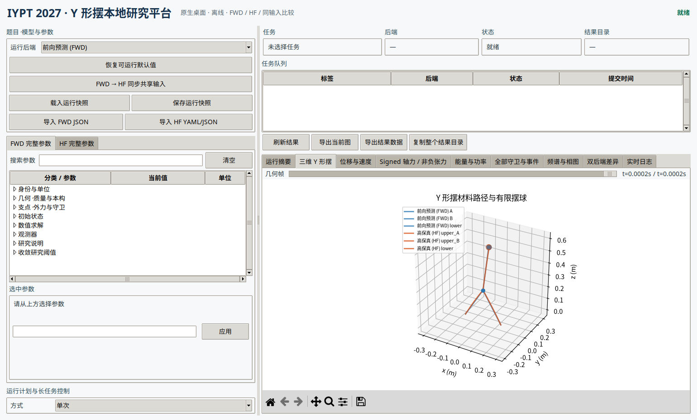

# Y 形摆原生本地桌面平台

## 1. 定位与边界

这是一个人科研计算工具，不是面向多用户或公网部署的产品。默认界面由 Python `tkinter` 与 Matplotlib 构成：

- 只创建本地原生窗口；
- 不启动浏览器，不监听 HTTP 端口；
- 不需要邮箱、账号、登录或联网；
- 不在 GUI 内重写物理方程，而是调用原 FWD 与 HF 求解器。

历史 Streamlit 界面保留为开发备份，不是默认入口。



## 2. 启动

在项目目录中执行：

```bash
.venv/bin/python -m ypendulum.cli ui
```

安装为本地包后也可以执行：

```bash
ypendulum ui
# 或
ypendulum-desktop
```

无显示器环境的构造性烟雾测试：

```bash
xvfb-run -a .venv/bin/python -m ypendulum.cli ui --smoke-test
```

旧 Web 备份只在显式请求时启动：

```bash
ypendulum ui-web
```

## 3. 界面结构

左侧为完整参数与运行计划，右侧为任务状态与科学结果。

### 3.1 参数编辑

- FWD 与 HF 分别按配置章节折叠显示。
- 启动默认快照中 FWD `237` 个叶字段、HF `115` 个叶字段全部有界面控件。
- 每个字段显示中文名、配置路径、单位、说明与合法范围。
- 标量使用输入框，枚举量使用下拉框，布尔量使用开关，向量/矩阵使用逗号/分号分量输入。
- FWD 退出守卫使用结构化对话框，无需手写 JSON。
- 可载入/保存整个桌面运行快照，也可导入现有 FWD JSON 或 HF YAML/JSON。载入后实际参与计算的所有已解析叶字段都会自动生成控件。

配置文件是保存、载入和复现格式，不是日常输入界面。启动时已有可运行默认参数。

### 3.2 运行方式

同一窗口支持：

- FWD 单后端；
- HF 单后端；
- FWD → HF 共享输入同步后的双后端比较；
- 单次、重复、批量、显式参数扫描与同输入双后端。

扫描工具只允许选择数值叶字段，先生成每个显式参数快照，再提交运行。它不会在求解器运行期间隐式修改参数。

### 3.3 长任务控制

- **开始**：提交完整快照。
- **暂停 / 继续**：对求解器独立进程组发送 `SIGSTOP` / `SIGCONT`。
- **停止**：先 `SIGTERM`，超时才 `SIGKILL`。
- **日志**：窗口内显示选中任务的实时尾部日志。
- **进度**：在配置、FWD、HF、比较和完成阶段显示。自适应积分器未提供可信的百分比时，界面使用不伪造数值的不定进度。
- 界面关闭不会自动杀死正在计算的进程；再次启动可恢复任务列表。

独立案例可在界面中选择 `1–12` 个同时 CPU 任务。这只用于相互独立的重复/批量/扫描成员；不会改变单条轨迹的求解顺序。

## 4. 结果视图

窗口内直接读取规范 NPZ/HDF5 结果，不修改科学产物：

1. 三维 Y 形材料路径、有限结点与有限半径摆球；
2. 摆球位移与速度；
3. 有符号轴力 `signed axial force`与事件用非负 `tension`；
4. 能量、耗散、基座/空气功率与平衡余量；
5. FWD 全部守卫分量和 HF 11 个守卫，以及事件时刻；
6. 摆球频谱和 `x–v_x` 相图；
7. 同输入 FWD/HF 摆球位置、速度差。

可导出当前图为 PNG/PDF/SVG，导出下采样仪表数据为 CSV，或复制包含规范轨迹、配置和诊断的完整结果目录。

## 5. 启动默认案例的实测

默认是 `0.2 ms`、`12/12/20` 网格的快速可见运行，用于确认安装、参数、控制和结果链，不是物理长窗预测。

本机双后端实测：

| 项目 | 结果 |
|---|---:|
| 总墙钟 | `20.25 s` |
| 平均 CPU 占用 | `1609%` |
| 峰值 RSS | `263672 KiB` |
| FWD/HF 样本 | `81 / 81` |
| 公共时窗 | `0–0.0002 s` |
| 摆球位置 RMS 模型差 | `8.4421e-8 m` |
| 摆球位置最大模型差 | `1.8698e-7 m` |
| 摆球速度 RMS 模型差 | `1.0827e-3 m/s` |

该差值是两种模型在极短共同时窗的形式差，不是网格收敛误差，也不能替代目标长窗计算。

## 6. 科学状态与局限

- FWD `COMPLETED/SUCCESS_SINGLE_RUN` 表示该单条前向轨迹完成。
- HF 无事件原始轨迹固定保留 `UNDETERMINED/SUCCESS_SINGLE_RUN_GUARDS_UNCERTIFIED`；桌面程序只将其视为“可读的个人科研结果”，不会伪称已完成可选全窗独立资格证书。
- 守卫/接触事件导致的前缀轨迹保留为 `OUT_OF_SCOPE_PREFIX`；其他数值错误不显示为成功。
- 当前并行主要来自科学数值库的多线程线性代数，以及 GUI 的独立案例多进程。自适应 Radau/BDF 与事件定位仍在 CPU，没有为界面而重写为 GPU 算法。
- 启动默认案例只证明软件整链可运行。正式研究应载入或在界面设置目标时窗与网格，并进行代表性网格/时间步敏感性检查。
