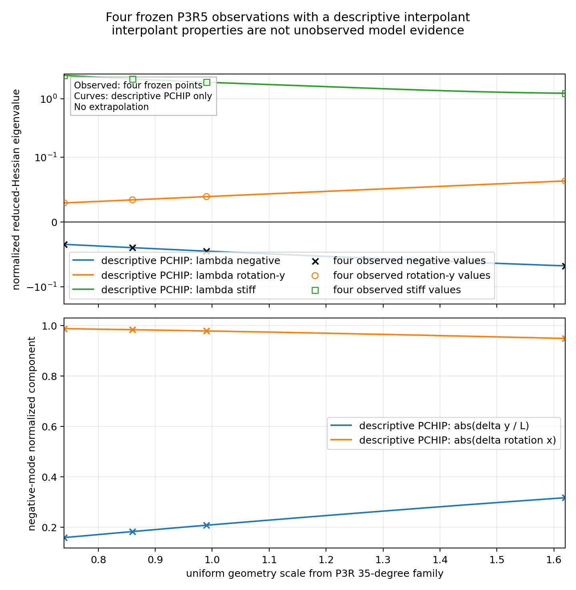

# P3R5 尺度开发集的负曲率方向与约化 Hessian 图谱

## 1. 结论

四张冻结 P3R5 尺度卡中的负方向不是任意六自由度混合，也不是单独的摆球平移。按冻结归一化坐标，它只包含：

- 垂直于支点连线的摆球侧向平移 $\delta y/L$；
- 绕支点连线的摆球滚转 $\delta\theta_x$。

四张卡的第三个相关自由度 $\delta\theta_y$ 以及与负方向正交的侧移—滚转组合均保持正曲率。故固定双活动参考的三维支撑切空间在四个已观察尺度点上都是 $(-,+,+)$ 谱符号，即候选参考是允许方向上的鞍点，而不是冻结资格定义所需的严格局部极小值。

这只是 P3R5 静态、刚性、无摩擦、单边接触候选模型中固定双活动分支的结论。它不是装置不稳定结论，也不是接触律、动态接触或实验验证。

## 2. 数据边界

分析只读取以下两份冻结工件：

- `p3r5_holdout_cards.json`，SHA-256 为 `48f418094ef7ccaa595a63a080f65f82d5b0125eaec0fb25cc58acf823bcb0f0`；
- `p3r5_admissibility_metrics.json`，SHA-256 为 `e93eb9a0cb074ca1cc9a137149b89b8d2c4384f100c9a9eefaf5c0ff79a3f987`。

本分析没有生成新留出卡、没有装配新接触算例、没有运行参考构造器、没有运行 G3R5，也没有修改 P3–P3R5 的任何冻结文件、阈值、目标或状态。

## 3. 坐标和方向解释

冻结六坐标按下列顺序归一化：

$$
\widehat q=
\left(
\frac{\delta x}{L},
\frac{\delta y}{L},
\frac{\delta z}{L},
\delta\theta_x,
\delta\theta_y,
\delta\theta_z
\right).
$$

四张尺度卡的负方向都可写为

$$
v_-(s)=
\left(0,a(s),0,b(s),0,0\right)^{\mathsf T},
\qquad
a(s)^2+b(s)^2=1.
$$

其正交侧移—滚转方向和独立转动方向为

$$
v_+(s)=
\left(0,-b(s),0,a(s),0,0\right)^{\mathsf T},
$$

$$
v_y=
\left(0,0,0,0,1,0\right)^{\mathsf T}.
$$

因此，负模态的物理图像是：摆球在 $y$ 方向侧移，同时绕 $x$ 轴滚转，使两个已声明活动的上支—摆球接触继续满足一阶切向约束。单独侧移或单独滚转都不是冻结特征方向；不稳定性来自二者的接触保持组合。

## 4. 已观察谱

| 留出卡 | 尺度 $s$ | $a$ | $b$ | $\lambda_-$ | $\lambda_y$ | $\lambda_+$ |
|---|---:|---:|---:|---:|---:|---:|
| `R5_SCALE_H01` | 0.74 | 0.158456 | 0.987366 | -0.0346075 | 0.0292632 | 2.50919 |
| `R5_SCALE_H04` | 0.86 | 0.182383 | 0.983228 | -0.0397383 | 0.0339408 | 2.17527 |
| `R5_SCALE_H02` | 0.99 | 0.207524 | 0.978230 | -0.0450971 | 0.0389873 | 1.90735 |
| `R5_SCALE_H03` | 1.62 | 0.316654 | 0.948541 | -0.0678280 | 0.0631379 | 1.23831 |

所有负方向的矩阵曲率均与独立方向曲率在既有交叉误差内相符。随着统一尺度增大，归一化负模态中的侧移分量增加、滚转分量下降；换算为物理单位后，每米侧移所需的滚转量随尺度显著下降。这是几何相似缩放下接触保持运动的自然表现，不是新的装置定律。

## 5. 约化 Hessian 参数化

在三维坐标

$$
\xi=
\left(
\frac{\delta y}{L},
\delta\theta_x,
\delta\theta_y
\right)^{\mathsf T}
$$

中，令

$$
V(s)=
\begin{bmatrix}
a(s) & -b(s) & 0\\
b(s) & a(s) & 0\\
0 & 0 & 1
\end{bmatrix}.
$$

则冻结点上的约化 Hessian 写成

$$
H_{\rm red}(s)=
V(s)
\operatorname{diag}
\left(
\lambda_-(s),
\lambda_+(s),
\lambda_y(s)
\right)
V(s)^{\mathsf T}.
$$

相应的局部势能展开为

$$
\Delta\Pi=
\frac12\xi^{\mathsf T}H_{\rm red}(s)\xi
+O\left(\lVert\xi\rVert^3\right).
$$

程序分别对 $\lambda_-$、$\lambda_+$、$\lambda_y$ 和模态角 $\alpha=\operatorname{atan2}(b,a)$ 作保持形状的分段三次 Hermite 参数化。参数域严格限制为四张冻结卡的凸包 $0.74\le s\le1.62$，禁止外推；每一段的多项式系数保存在 `outputs/stability_map.json` 中。

## 6. 稳定性图与分岔解释上限



在已观察区间内，$\lambda_-(s)$ 始终严格小于零，另外两个特征值始终为正。图中没有观察到 $\lambda_-=0$ 的过零点。因此本轮不能把该分支归类为鞍结、对称破缺或活动集切换，也不能用区间外外推制造一个“临界尺度”。

可以支持的最窄结论是：四张尺度开发卡及其区间内的有界形状保持描述都显示固定双活动候选参考具有侧移—滚转负模态。分岔类型仍未知，且真实装置是否出现相应方向必须由柔顺、摩擦、动态切换和实验观测决定。

## 7. 可复现性与停止门

运行命令为：

```bash
PYTHONPATH=src python -m p3r5_stability_map \
  --config config.json \
  --repository-root ../../../.. \
  --output outputs
```

输出 JSON、CSV、SVG、PNG 和 SHA-256 工件清单。F0 完成后，本分析不开放 P3R6、新接触资格卡、G3R5、动力学或动态接触。
