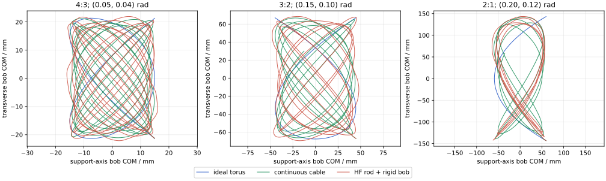

# Y 形摆：三锚点模型阶梯

## 1. 结论

本目录完成了上一轮无实验参数图谱指定的三个锚点，并在同一组可审计输入下依次运行三个不同模型：

- `FWD-TORUS-1.0`：理想、对称、始终张紧的环面模型；
- `FWD-CABLE-1.0`：连续、仅承受拉力的柔索有限元模型；
- `HF-DISCRETE-ROD-RIGID-BOB-1.0`：离散杆与刚性摆球高保真模型。

三锚点共完成 24 个锁定运行，包括 9 个基线、3 个理想模型时间检查，以及柔索和高保真模型各 6 个时间或空间加密运行。运行期间，正式源代码、图谱源、候选脚本和 Git HEAD 的身份保持不变；每个锚点的 53 项柔索—高保真共享输入审计均通过。

结果不支持把理想模型的有限振幅调谐值直接当作真实装置预测。由理想环面改为柔索后，三个锚点的拟合频率比分别从接近 `4:3`、`3:2`、`2:1` 移到约 `1.2264`、`1.3203`、`1.5265`；加入高保真结构自由度后又移到约 `1.2134`、`1.2995`、`1.4946`。这种模型形态偏移远大于本轮时间步敏感度。

当前结论上限是：**候选模型形态比较与两层敏感度计算已完成；数值收敛、连续守卫认证、物理预测和实验验证均未完成。** 高保真结果仍为 `SUCCESS_SINGLE_RUN_GUARDS_UNCERTIFIED` 和 `UNDETERMINED`，且空间加密差异尚不可忽略，因此对装置尺寸建议保持 `NO-GO`。

## 2. 锚点与输入映射

三个锚点沿用无实验参数图谱的数值调谐几何。下支长度为 $\ell=0.300\,\mathrm{m}$，半支座跨度保持 $a=0.4h$，摆球质量为 $0.080\,\mathrm{kg}$，三支轴向刚度均取 $EA=12.0\,\mathrm{N}$。

| 锚点 | 释放振幅 $(A_\phi,A_\theta)$ / rad | 数值调谐 $h/\ell$ | 高度 $h$ / m | 支座跨度 / m | 积分时长 / s |
|---|---:|---:|---:|---:|---:|
| `4:3` | `(0.05, 0.04)` | 0.777888138 | 0.233366 | 0.186693 | 15.0195 |
| `3:2` | `(0.15, 0.10)` | 1.253365103 | 0.376010 | 0.300808 | 11.9601 |
| `2:1` | `(0.20, 0.12)` | 3.008061758 | 0.902419 | 0.721935 | 9.35053 |

每条轨迹覆盖三个目标公共周期，并额外保留 $1.25$ 个慢模态周期用于稳健拟合。三个公共周期分别对应 `4:3` 的 9 个、`3:2` 的 6 个和 `2:1` 的 3 个慢模态周期。

模型映射遵守以下边界：

1. 三个模型共用支座、重力坐标系和摆球质心端点状态；
2. 柔索与高保真配置由正式桌面映射函数生成并执行逐字段共享输入审计；
3. 两条上支使用相同原长，其预伸长由理想初始两条上支张力的平均值确定，而不是强行令非对称释放瞬间的两条上支张力相等；
4. 柔索使用 `STATIC_HOLD_RELEASE`，高保真保留刚性摆球表面连接并使用 `held_endpoint_equilibrium_release`；二者的内部自由度准备方式不同，不能当作同一方程的两个网格；
5. 高频、慢频、相位、闭合和轨迹差异统一从摆球质心的公共笛卡尔观测量计算。

柔索静态准备固定使用 5 个确定性多初值、最多 5000 次迭代和 $10^{-6}\,\mathrm{N}$ 的无穷范数梯度阈值。三个基线选中状态的梯度分别约为 $9.48\times10^{-7}$、$1.82\times10^{-7}$ 和 $7.06\times10^{-7}\,\mathrm{N}$。这只是本轮先导计算锁定的离散准备阈值，不是全局唯一性或静力资格证明。

## 3. 基线结果

### 3.1 频率、相位与公共周期闭合

`频率比误差` 指拟合快慢频率比减去目标有理数；`相位漂移` 是三个公共周期上的共振相位变化；`闭合误差` 是四状态归一化闭合误差。

| 锚点 | 模型 | 拟合频率比 | 频率比误差 | 相位漂移 / rad | 闭合误差 |
|---|---|---:|---:|---:|---:|
| `4:3` | 理想环面 | 1.333332850 | -4.84e-7 | -8.21e-5 | 1.15e-4 |
| `4:3` | 连续柔索 | 1.226436257 | -0.106897 | -18.1347 | 0.303648 |
| `4:3` | 高保真 | 1.213364074 | -0.119969 | -20.3523 | 0.533297 |
| `3:2` | 理想环面 | 1.500000946 | +9.46e-7 | +7.13e-5 | 7.03e-4 |
| `3:2` | 连续柔索 | 1.320334946 | -0.179665 | -13.5464 | 0.503530 |
| `3:2` | 高保真 | 1.299537767 | -0.200462 | -15.1145 | 1.13548 |
| `2:1` | 理想环面 | 2.000030325 | +3.03e-5 | +5.72e-4 | 5.25e-4 |
| `2:1` | 连续柔索 | 1.526515964 | -0.473484 | -8.92496 | 1.80670 |
| `2:1` | 高保真 | 1.494559462 | -0.505441 | -9.52733 | 1.86739 |

所有拟合均被脚本标记为可靠，快、慢模态的拟合 $R^2$ 均不低于约 `0.995`。但高拟合度只说明选定有限窗内的二频表示有效，不能把目标频率比的明显偏移解释为锁频、分岔或实验现象。

### 3.2 模型形态轨迹差异

下表在公共输出网格上比较完整基线时段内的摆球质心位置。`RMS` 是三维点距离的均方根，`最大值` 是最大三维点距离。

| 锚点 | 参考模型 → 候选模型 | RMS / m | 最大值 / m |
|---|---|---:|---:|
| `4:3` | 理想环面 → 连续柔索 | 0.03190 | 0.04929 |
| `4:3` | 连续柔索 → 高保真 | 0.02474 | 0.03825 |
| `4:3` | 理想环面 → 高保真 | 0.03906 | 0.05736 |
| `3:2` | 理想环面 → 连续柔索 | 0.09866 | 0.15438 |
| `3:2` | 连续柔索 → 高保真 | 0.03603 | 0.06396 |
| `3:2` | 理想环面 → 高保真 | 0.10467 | 0.16029 |
| `2:1` | 理想环面 → 连续柔索 | 0.20134 | 0.30531 |
| `2:1` | 连续柔索 → 高保真 | 0.03068 | 0.05640 |
| `2:1` | 理想环面 → 高保真 | 0.20520 | 0.31431 |

这些差异包含长期相位积累，不能单独分解为某一物理效应；它们足以否定“只要初始几何相同，三个模型就会给出等价轨迹”的假设。



### 3.3 轴力、能量与守卫

连续柔索三个基线的最小有符号轴力分别为 `0.3792 N`、`0.2706 N` 和 `0.2688 N`，采样点内均保持拉力状态。其最大相对功率平衡残差分别为 `7.84e-7`、`4.31e-7` 和 `2.34e-7`。

高保真基线必须单独解读：

- `4:3` 在首个采样点即出现负有符号轴力，三支最小值中的最低值为 `-0.0455 N`；细网格仍出现负轴力，最低值为 `-0.0205 N`。
- `3:2` 基线最小轴力为 `+0.00219 N`，但细网格在 `t=0.025 s` 出现负轴力，最低值为 `-0.00158 N`。
- `2:1` 基线和细网格的最小轴力分别为 `+0.0158 N` 和 `+0.0125 N`。
- 三个高保真基线的最大绝对归一化能量平衡残差分别为 `1.56e-4`、`4.74e-5` 和 `1.84e-5`。
- 三个高保真基线都没有记录离散守卫事件，但最小归一化守卫裕量只有约 `4.84e-5`、`3.66e-5` 和 `1.58e-5`，而且正式返回明确要求连续的已接受步守卫证书。

负有符号轴力不是“负张力”；高保真后端使用双侧轴向材料律，而柔索后端只承受拉力。这里必须同时报告有符号轴力与截断后的拉力，不能把压缩样本隐藏为零张力后再声称模型一致。

## 4. 时间与空间敏感度

基线输出步长为 `0.005 s`。柔索和高保真时间加密把最大步长减半，并把相对容差从 `1e-7` 收紧至 `3e-8`；理想模型也执行最大步长减半。空间加密同时使用收紧后的时间设置，并把柔索单元数从 `(2,2,3)` 加密为 `(4,4,6)`，把高保真三支从每支 1 个单元加密为每支 2 个单元。

时间加密的摆球质心轨迹 RMS 差异很小：柔索约为 `5.50e-10` 至 `2.24e-9 m`，高保真约为 `2.16e-8` 至 `3.20e-8 m`；理想模型处于浮点舍入量级。当前主要不确定性不是时间步。

空间加密结果如下：

| 锚点 | 模型 | 轨迹 RMS 差异 / mm | 频率比绝对差 | 闭合误差绝对差 |
|---|---|---:|---:|---:|
| `4:3` | 连续柔索 | 0.00937 | 4.35e-6 | 1.19e-4 |
| `4:3` | 高保真 | 1.04064 | 1.12e-3 | 9.72e-2 |
| `3:2` | 连续柔索 | 0.16696 | 1.48e-4 | 3.66e-3 |
| `3:2` | 高保真 | 1.47184 | 2.83e-3 | 6.84e-2 |
| `2:1` | 连续柔索 | 1.06839 | 1.29e-3 | 8.61e-3 |
| `2:1` | 高保真 | 8.25350 | 3.75e-3 | 1.11e-2 |

这里只比较了两个离散层级，没有第三层级、观察阶或外推值，因而**不是网格收敛证明**。特别是高保真使用 `quick` 配置、每支 1 或 2 个单元，并显式允许低于正式最小网格；空间加密还改变了 `3:2` 的轴力符号判定。当前高保真空间离散资格为 `NO-GO`。

## 5. 已执行的验证

本轮实际完成：

1. 候选脚本单元测试，覆盖三锚点几何、模型身份、共享输入审计、合成双模态频率与闭合恢复、公共网格轨迹比较；
2. 三模型短时冒烟运行；
3. 24 个正式候选运行与可重启缓存；
4. 三锚点各 53 项柔索—高保真共享输入审计；
5. 运行开始和结束的正式前向源、高保真源、图谱源、候选脚本与 Git HEAD 身份对比；
6. 理想模型时间检查，以及柔索和高保真模型的时间、空间两层敏感度；
7. 张力与有符号轴力、能量账、首个非拉力采样和守卫摘要；
8. CSV、JSON、SVG 和 SHA-256 清单生成；
9. README 的 Pandoc Markdown 解析，以及嵌入数学、表格和 SVG 的独立 HTML 实际渲染与视觉检查。

本轮没有执行或没有通过的资格项：

- 三层及以上空间/时间收敛与外推；
- 高保真正式生产网格和连续已接受步守卫证书；
- 柔索与高保真之间的材料律极限或结构参数归因研究；
- 参数校准、实验复现、盲测和装置级不确定度传播；
- 真实装置频率比、图样或尺寸建议验证。

目录/配置检查、实现级测试、两层数值敏感度、物理验证和实验验证是不同证据层级。本目录的 `COMPLETE_RETURN_SET` 只表示预定返回集齐全，不表示后四项自动通过。

## 6. 结果文件

- `results/anchor_definitions.json`：三锚点几何、预伸长和名义周期；
- `results/anchor_run_metrics.csv`：24 个运行的扁平化关键指标；
- `results/model_form_differences.csv`：三个模型对的公共时段轨迹差异；
- `results/refinement_sensitivity.csv`：时间与空间两层差异；
- `results/run_summary.json`：完整配置身份、共享输入审计、准备状态、守卫、轴力、能量和运行环境；
- `figures/three_anchor_modal_trajectories.svg`：三锚点基线轨迹；
- `MANIFEST.sha256`：脚本与正式结果文件的内容清单。

`generated/` 只保存可重启运行缓存，已被 Git 忽略，不属于正式候选交付。

## 7. 复现

在本目录执行：

```bash
python3 -m venv .venv
.venv/bin/python -m pip install -r requirements.txt
.venv/bin/python -m pytest -q tests
.venv/bin/python model_ladder.py --smoke --output-root /tmp/y-pendulum-model-ladder-smoke
.venv/bin/python model_ladder.py --refinement-scope all
sha256sum -c MANIFEST.sha256
```

本轮记录的运行环境为 Python `3.12.3`、NumPy `2.5.2`、SciPy `1.18.1`、Pydantic `2.13.4`、h5py `3.16.0`、pandas `3.0.5`、Matplotlib `3.11.1` 和 Pint `0.25.3`。候选需求明确限制 `numpy>=2.0`，因为当前正式前向实现使用 `numpy.trapezoid`；系统环境中仅满足旧版宽松声明的 NumPy 不能复现本候选运行。

修改 `model_ladder.py`、正式源、图谱源或运行配置后，已有缓存会因身份或配置哈希不匹配而自动失效。需要无条件重算时可加 `--force`。

## 8. 下一步与停止条件

下一步不是继续扩大锚点数量，而是先解决高保真空间资格：

1. 使用不少于三个正式允许的网格层级，分别检查频率、相位、闭合、轴力符号、能量账和所有守卫裕量；
2. 取得连续已接受步守卫证书，并定位 `4:3` 与 `3:2` 的压缩样本是初态映射、离散误差还是双侧材料律的真实模型分歧；
3. 对柔索与高保真之间的差异做逐项结构参数极限研究，而不是把两个模型后端直接互换；
4. 数值资格满足后，再定义可测实验输入、校准集和盲验证集。

在上述工作完成前，不应把三个锚点转化为加工公差、最佳频率比或真实装置轨迹预测。
